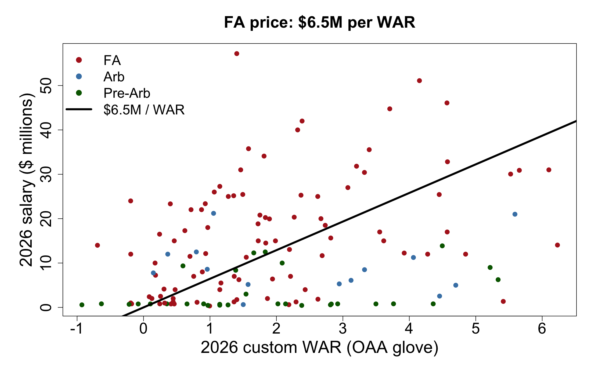
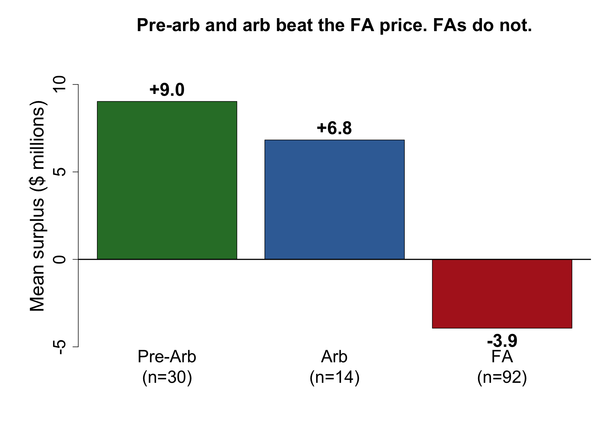
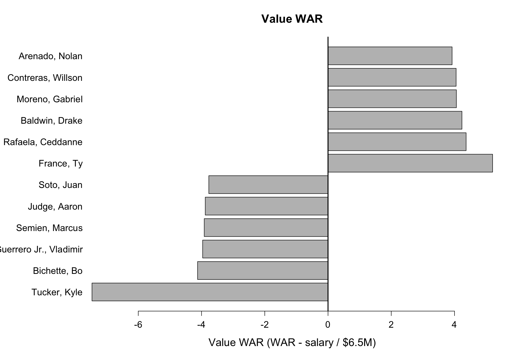

```{r setup, include=FALSE}
knitr::opts_chunk$set(echo = FALSE, warning = FALSE, message = FALSE, fig.align = "center")
```

Can 2026 on-field WAR explain 2026 position-player salaries, and who was over or under their contract?

Batting is pitch-level `delta_run_exp`. Fielding is Statcast Outs Above Average, converted to runs with Savant's `fielding_runs_prevented`. A win is priced from free agents only (line through the origin). Surplus and value WAR score everyone with a salary against that price.

Not FanGraphs WAR.

## Why OAA, not xBA

The first glove was `expected_babip − hit` on balls in play. xBA is exit velo and launch angle only, so a liner at the second baseman and a liner in the gap got the same expected hit rate. Converting a hard grounder you were standing on looked like elite defense. Brandon Lowe landed at 8 WAR with +32 fielding runs as a second baseman. That ranking was the model.

OAA is the Statcast range model: starting position, landing spot, hang time. Hard contact shows up as less time. After the swap, Pete Crow-Armstrong is 10.1 WAR (26 OAA / +23 runs). Lowe is 5.9 WAR (15 OAA / +11 runs). PCA is a glove-first CF. Lowe is a good regular.

Catchers and DH are not on the IF/OF OAA board, so they get 0 glove. Willson Contreras's 6.2 WAR is basically bat plus replacement.

## WAR

1. Keep PA-ending pitches. Batting RAA = player runs − league runs/PA × PA.
2. Join 2026 Savant OAA on MLBAM id. Fielding RAA = runs prevented. Missing → 0.
3. Regulars = top 390 in PA (13 jobs × 30 teams). WAR = (RAA − PA × replacement runs/PA) / 10.
4. Join salaries on batter id. FAs only: `lm(salary_m ~ 0 + WAR)` → **$6.45M per WAR**.
5. Surplus = expected pay − actual. Value WAR = WAR − salary / 6.45.

## Results

136 players have both WAR and a salary (92 FA, 14 arb, 30 pre-arb).

Among free agents, WAR vs salary correlation is 0.41. With an intercept, R² is 0.17. 2026 WAR does not explain 2026 FA pay. Contracts are forecasts. The line is still the open-market price of a win.

```{r}

```

Black line is $6.45M per WAR. Green (pre-arb) sits low on purpose.

```{r}

```

| Class | n | Mean surplus |
|---|---|---|
| Pre-arb | 30 | +$9.0M |
| Arb | 14 | +$6.8M |
| FA | 92 | −$3.9M |

Controlled players beat the FA price. FAs, on average, do not.

Value WAR (on-field wins minus wins the contract bought):

- High: Ty France (+5.2; $1.35M, 5.4 WAR), Ceddanne Rafaela, Drake Baldwin, Gabriel Moreno, Willson Contreras, Nolan Arenado.
- Low: Kyle Tucker (−7.5; $57.2M, 1.4 WAR), Bo Bichette, Vladimir Guerrero Jr., Marcus Semien, Aaron Judge, Juan Soto.
- Pete Alonso: 6.1 WAR at $31M → +1.3, roughly fair on this scale.

France was a cheap deal who played like a regular. That surplus is the contract, not a claim he is a $34M player next year. Tucker’s AAV is so large that one down season cannot cover it at $6.5M per win. Ohtani is hitter WAR only.

```{r}

```
